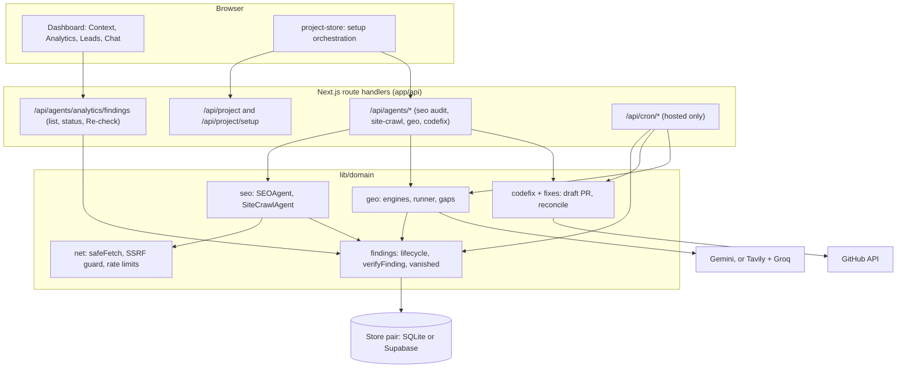
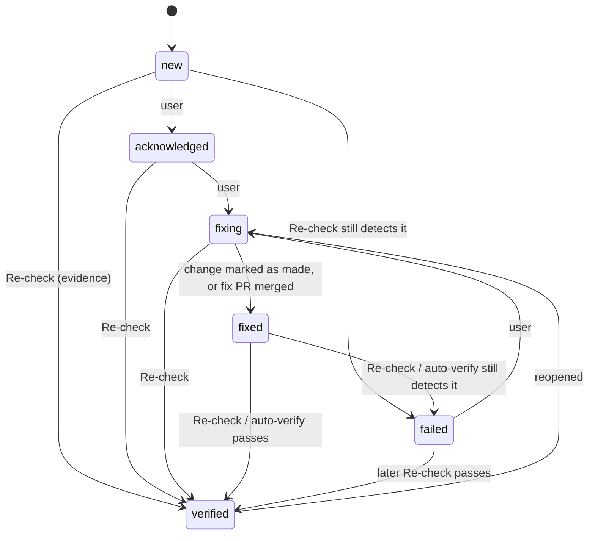
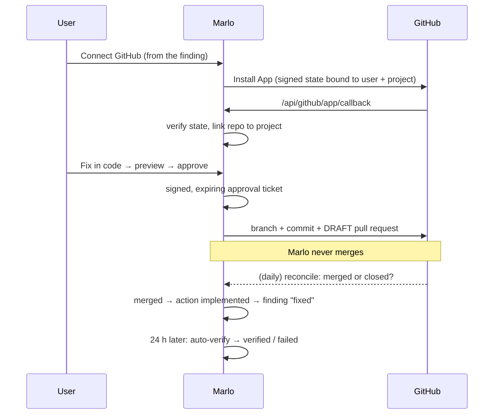

# Architecture

Marlo is a single Next.js 16 app (App Router, React 19, TypeScript). It has no separate backend service and no job queue. This page describes `main` as of #180.

## Layout

```text
app/            routes: dashboard/, settings/, pricing/, audit/ (public quick audit), login/, api/ (route handlers)
components/     UI: dashboard panels, findings, GEO, settings, pricing, shared ui/ primitives (Radix)
lib/domain/*    domain logic by area: findings, seo, geo, search, codefix, fixes, actions, project, plans, net, notifications ...
lib/llm/        model drivers and platform-managed keys
lib/jobs/       cron auth and time-budget runner
lib/db.ts       SQLite schema and connection (self-host)
utils/supabase/ Supabase clients (browser, server, service role)
supabase/migrations/  Postgres schema (apply in filename order)
tests/          node:test unit suites (npm test)
e2e/            Playwright suites (manual)
```

## Two modes, one codebase

`resolvePlatformMode()` in `lib/features.ts` picks the mode (rules in [self-hosting.md](self-hosting.md)).

- **Self-host (SQLite).** `lib/db.ts` opens `data/okara.db` in WAL mode and creates tables on first use. There is no sign-in. Provider keys are stored in SQLite.
- **Hosted (platform).** Supabase Auth and Postgres. `proxy.ts` refreshes the session on every request and answers 503 if platform mode lacks Supabase config. Routes call `auth.getUser()`, and trusted writes use the service-role client (`utils/supabase/serviceClient.ts`). Secrets are kept in Supabase Vault.

### Store pairs

Persistence sits behind a pair of files per store, with the same shape on both sides:

| Domain | SQLite | Supabase |
|---|---|---|
| Findings | `lib/domain/findings/findingStore.ts` | `findingStoreSupabase.ts` |
| Actions | `lib/domain/actions/actionStore.ts` | `actionStoreSupabase.ts` |
| GEO runs | `lib/domain/geo/geoStore.ts` | `geoStoreSupabase.ts` |
| Search snapshots | `lib/domain/search/searchSnapshotStore.ts` | `searchSnapshotStoreSupabase.ts` |
| Setup state | `lib/domain/project/setupStateStore.ts` | `setupStateStoreSupabase.ts` |
| Notifications, integrations, lead profile, social drafts | `*Store.ts` | `*StoreSupabase.ts` |

Rules: Supabase stores always filter by both `user_id` and `project_id`, and a platform route never falls back to SQLite. Domain functions take their storage and network as ports, so most of `lib/domain` is pure and unit-tested without a database.

## Data flow



The dashboard reads project data through TanStack Query, mostly from `GET /api/project/data`, which returns one bounded payload of real documents, audits, findings and more.

## Project setup and setup state

Setup is **orchestrated by the browser** (`lib/project-store.tsx`). After `POST /api/project` creates the project, the client runs the steps in this order (`SETUP_STEPS` in `lib/domain/project/setupState.ts`):

`audit → description → competitors → leads → product-info → marketing-strategy → competitor-analysis → competitor-comparison → content-strategy → design-guide`

- Each step's status (`pending | running | done | failed | skipped`) is saved through `PUT /api/project/setup` into `project_setup_state` (Supabase) or the matching SQLite table. A pure reducer decides the legal transitions.
- When the project loads again, the client asks for the steps that are still missing and runs only those. The finish-setup checklist reads the same state and has a Retry button per step.
- If the table is missing (migration not applied), setup still runs. It just cannot resume.
- **Limit:** nothing runs on the server while the tab is closed. A server-side setup runner is not built.

## Findings lifecycle

A finding is keyed by project, source, category, entity and URL. Its sources are the SEO audit, the Lighthouse audit, Search Console opportunities, and GEO gaps.



- `verified` and `failed` are **evidence-only** (`EVIDENCE_ONLY_STATUSES` in `findingTypes.ts`). A user cannot set them directly. Only a check can.
- **Re-check** (`recheckDecision.ts` → `verifyFinding.ts`) runs the real check again. If the check could not run, timed out, or was redirected to another page, the result is **skipped**: nothing changes, and the UI says why (#180).
- **Auto-verify** (hosted, `autoVerifyJob.ts`, inside `search-monitor`) checks a `fixed` finding once its change has been live for 24 hours. It makes at most 3 decided attempts and gives up after 10 skips, leaving the finding to a manual Re-check.
- **No longer detected** (`vanishedFindings.ts`). When a newer audit of the same page no longer reports an open finding's issue, the finding gets `evidence.vanished`. Its status does not change. It is not verified until a Re-check confirms it. The flag is cleared if the issue shows up again. Lighthouse findings are only flagged when that audit actually ran Lighthouse, and a redirect never counts.
- **GEO gaps** (`lib/domain/geo/geoGaps.ts`). A prompt that misses the project in at least 2 of its last 3 stored runs becomes a `geo_gap` finding. There is one method per finding, and real Gemini runs win over simulated ones. The two are never counted together. A failed call stores no row, so it never counts as a miss. A gap is verified only by a **later** run of the same prompt and method that names the project.
- **Fix first** (`lib/domain/overview/fixFirst.ts`) picks the top open findings in a deterministic order for the strip above the list.

## Scheduled jobs (hosted only)

Defined in `vercel.json`. They are authorized by `isAuthorizedCron` (`lib/jobs/jobRunner.ts`), which compares a `CRON_SECRET` bearer token in constant time, and they return 404 in self-host mode.

| Route | Schedule (UTC) | Phases |
|---|---|---|
| `/api/cron/leads-refresh` | daily 00:00 | Leads for projects with a confirmed lead profile |
| `/api/cron/search-monitor` | daily 03:00 | Search Console snapshots (45 s) → daily proposals → fix-PR reconcile (8 s) → social drafts (15 s) → auto-verify and monitor (20 s) → notifications (until 57 s). Also prunes old cron marker rows |
| `/api/cron/geo-weekly` | Monday 05:00 | GEO prompt runs, 3 projects at a time |

Every job is idempotent for its day or week and stops before the 60-second function limit. Selection reads are paged (#162). The weak spot is **coverage, not correctness**: one time-boxed run a day reaches a limited number of projects, so a large fleet is covered slowly. Calling the routes more often is safe.

## GitHub App fix loop (hosted)



- Approval tickets are signed with a key derived from `GITHUB_APP_CLIENT_SECRET` (or `NOTIFY_SIGNING_SECRET`). Hosted fails closed if neither is set.
- Duplicate and orphan PRs are prevented (#129). Outcomes are measured from the merge day (#126).
- Self-host uses a personal token and repository saved in Settings instead of the App.

## Outbound requests and limits

- `lib/domain/net/safeFetch.ts` handles every URL that a user or a user's page can influence. It pins DNS, validates every redirect hop, enforces a total deadline and a 2 MB body cap, and returns fixed error messages.
- `lib/domain/net/providerBaseUrl.ts` stops a user-supplied model base URL from pointing at private addresses on hosted. The operator's platform key is never paired with a user base URL (#170).
- Public, anonymous endpoints (`/api/public/audit`) use shared Postgres counters (`rate_limits`) on hosted, and an in-process limiter on self-host.

## Plans

`lib/domain/plans/planMatrix.ts` is the single source of truth for plan features and limits. `planPolicy.ts` decides the plan in effect. See [plans-and-pricing.md](plans-and-pricing.md).
